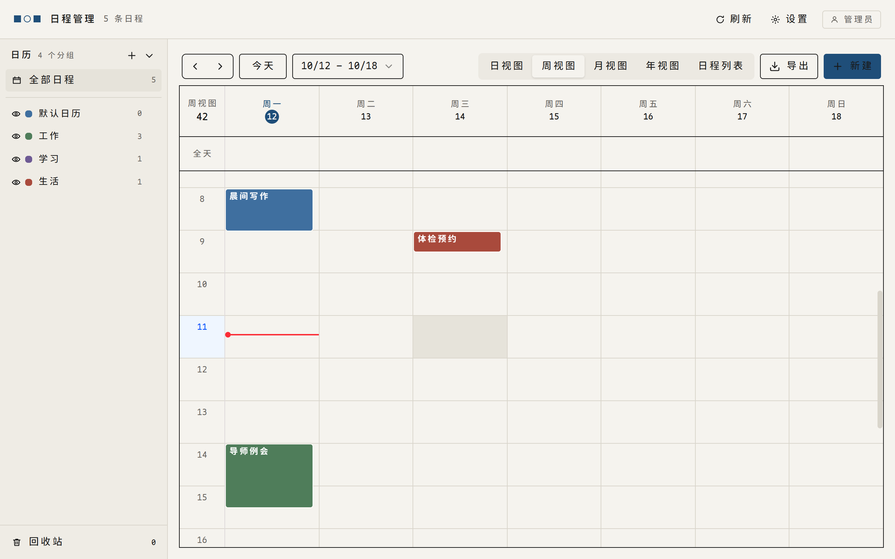
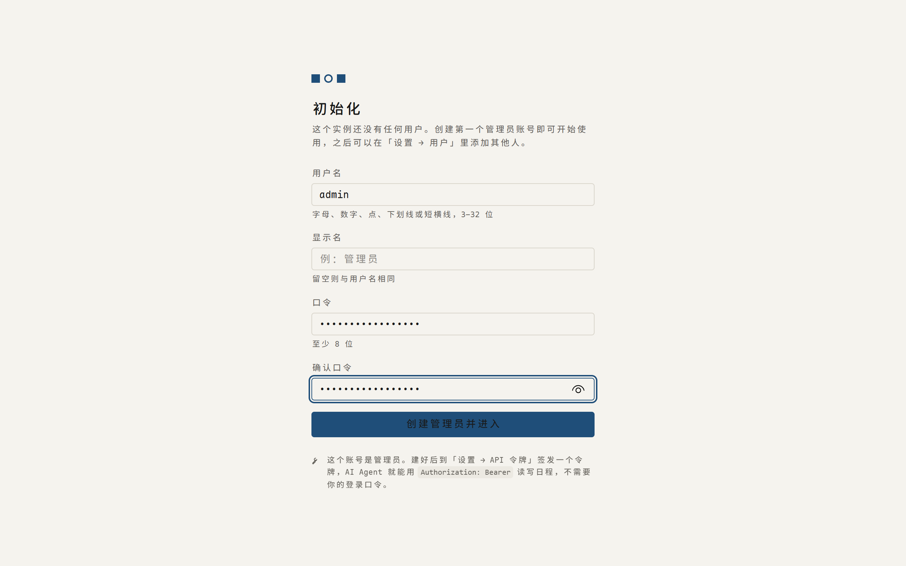
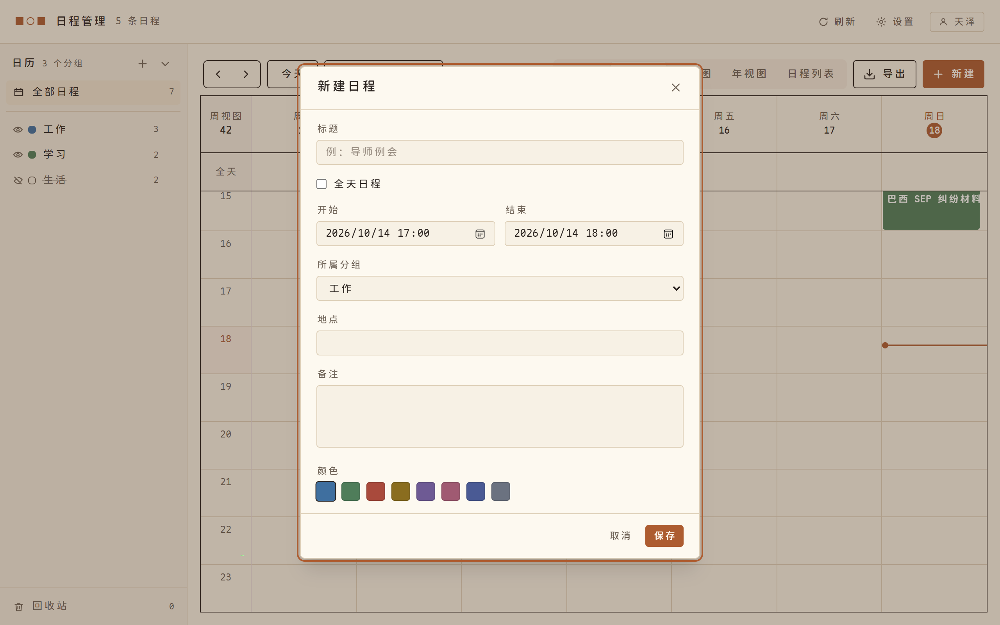
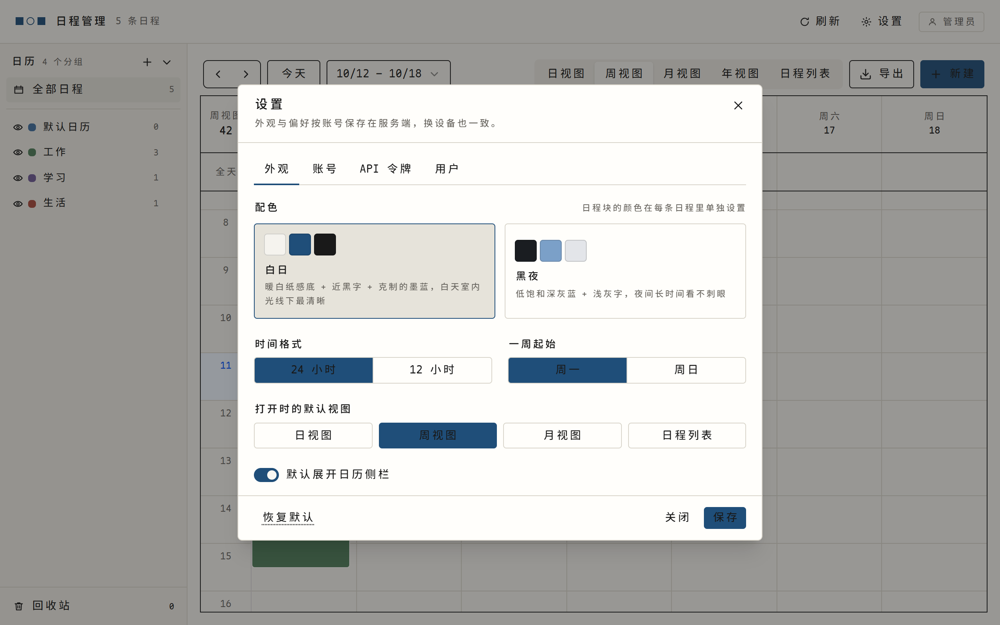
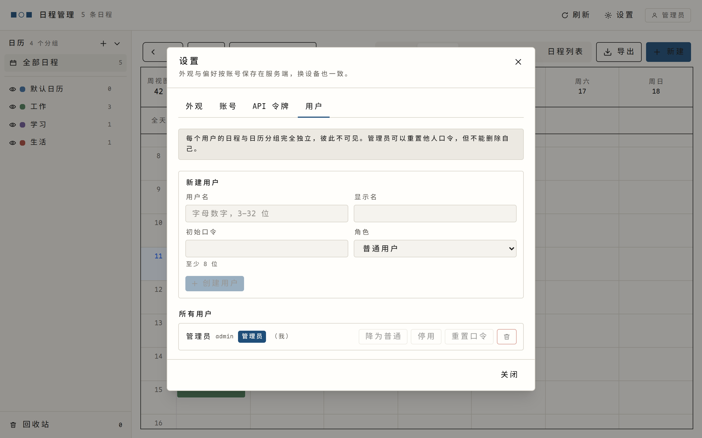

# morrow calendar

一个自带 AI-native REST 后端的日程管理系统，前端基于 [`@ilamy/calendar`](https://ilamy.dev) v3。

它的出发点是：浏览器里能做的事，AI Agent 也应该能通过接口做到。Agent 不用解析页面、不用截图识别，读一次 `GET /api/meta` 或拉一份 `GET /api/agent.md` 就能掌握全部能力，之后所有读写都走结构化 JSON。

| | |
| --- | --- |
| 前端 | React 19 + Vite + Tailwind 4 + `@ilamy/calendar` v3，日 / 周 / 月 / 日程列表四种视图 |
| 后端 | Node 22 + TypeScript + Express 4，SQLite 单文件持久化 |
| 多用户 | 浏览器初始化引导 → 口令登录（scrypt）+ 每用户可签发的 API 令牌，数据按用户严格隔离 |
| AI 协作 | `GET /api/meta` 自描述、`GET /api/agent.md` 一页简报、`dry_run` 试运行、幂等键、`Idempotency-Key`、机器可读错误码 |



## 为什么说它是 AI-native

「给 AI 留个接口」和「本来就是给 AI 用的」是两件事。这个项目在后者上做了一些具体的事，都不大，但连起来能让 Agent 少犯很多错：

**服务自描述。** `GET /api/meta` 一次返回鉴权方式、能力开关、全部枚举、各项上限，以及端点清单——每条都带 `riskLevel`（safe / confirm / danger）和是否需要登录。里面还塞了一份 `quickstart` 上手序列，照抄就能跑通一次完整读写。Agent 不必先读源码，也不必先啃文档。

**一页式简报。** `GET /api/agent.md` 把上面这些东西摊成一段 Markdown。人类用一条 `curl` 就能抓下来，直接贴进对话，省掉手工摘抄协议的环节。这份简报与 `/meta` 同源生成，不会出现两边各说各话。

**写操作可以预演。** 任何 `POST / PATCH / PUT / DELETE` 都能加 `?dry_run=true`，服务端返回将要发生的 `changes`（改动前后对比）与 `warnings`，但不落库。Agent 由此可以先把「打算做什么」摆出来让人看，得到同意再真写。

**错误是给机器读的。** 失败统一返回 `{ code, message, details, hint }`：`code` 是稳定枚举，`details` 精确到字段，`hint` 直接写下一步该做什么。Agent 按 `code` 分支就能自愈，不必去猜 `message` 里那句话什么意思。

**时间不用自己算。** `?window=today | tomorrow | this_week | next_7_days | ...` 交给服务端解析成区间，响应里的 `meta.resolvedRange` 把实际算出的范围带回来供核对。让模型去推算「下周」是哪几天，是很容易出错的一步。

**重试不会重复。** 创建时带 `Idempotency-Key`，重复提交会命中缓存并返回第一次的结果；并发写入用 `If-Match` + `version` 做乐观锁，拿到的是 `VERSION_CONFLICT` 而不是静默覆盖。

**批量可控。** `POST /api/events/batch` 单次最多 50 条，支持整批 `dry_run`，也支持 `atomic: true`（先全量预检，失败整批回滚），并逐条返回 `succeeded / failed`。

**风险分级写进了数据。** 端点的 `riskLevel` 不是文档里的君子协定，而是 `/meta` 里能读到的字段。Agent 可以据此决定哪些自主执行、哪些必须先问人，不需要把这套规则硬编码在自己的提示词里。

**回收站兜底。** 删除默认是软删除，恢复是一条 safe 接口。Agent 手滑删错，代价是一条命令，不是一次重建。

**面向 Agent 的协作规则也开源。** [`skills/morrow-calendar/SKILL.md`](skills/morrow-calendar/SKILL.md) 是一份写给 Agent 看的操作手册——确认流程、风险分级、时间与冲突处理、禁止事项。可以直接作为 skill 装进支持 skill 的客户端。

**原生支持 MCP。** 除了 REST，服务端内置了 Model Context Protocol 端点（[`/api/mcp`](#原生-mcp-接入)）。支持工具协议的客户端——ChatGPT、Claude Desktop、Cursor、Claude Code——填一个 URL 就能连上，自己发现能力，不用读协议文档，也不用手工描述每个接口。上面这些设计（dry_run、风险分级、回收站）在 MCP 里一样生效，而且写操作**默认就是试运行**，想真正落库必须显式传 `dry_run: false`。

## 功能

| 模块 | 能力 |
| --- | --- |
| 初始化 | 首次打开是浏览器里的引导页：自己填用户名和口令创建首个管理员，建完直接进入，不必去控制台抄一次性口令 |
| 日程 | 创建 / 查看 / 编辑 / 删除、拖拽移动、全天日程、颜色、地点与备注、时间冲突检测 |
| 视图 | 日、周、月、日程列表（Agenda），周起始日与 12/24 小时制可配 |
| 日历分组 | 多分组、整组显隐、改名换色、排序；删分组时组内日程自动迁入默认分组 |
| 回收站 | 删除默认进回收站，可逐条恢复、彻底删除或一键清空 |
| 多用户 | 口令登录（scrypt 哈希 + HttpOnly 会话）、管理员建号 / 停用 / 重置口令 / 升降角色 |
| API 令牌 | 每用户可签发多个长期令牌给 AI Agent 用，明文只显示一次，可随时吊销 |
| 外观 | 一昼一夜两套配色，切换即时生效并持久化到服务端 |
| AI 协作 | `dry_run` 预演、`Idempotency-Key` 防重、机器可读错误码、批量操作与原子回滚 |

## 快速开始（本地）

```bash
npm install
npm run dev          # 后端 8787 + 前端 5173
```

打开 http://127.0.0.1:5173，页面会显示「初始化」向导，在那里创建第一个管理员账号即可。库里一个用户都没有时，服务端不擅自建号，把这件事交给了浏览器。

如果你要部署在无浏览器的环境（容器、CI、纯 SSH），在启动前设好 `ADMIN_PASSWORD`，服务端会照旧自动建号并把口令打进启动横幅：

```bash
ADMIN_PASSWORD='你的口令' npm run dev
```

### 不想登录？本机单人模式

```bash
AUTH_ENABLED=false npm run dev
```

此时所有请求自动归属内置的 `local` 账号，前端不再出现登录页。只建议在本机用。

### 灌一点演示数据

```bash
npm run seed         # 5 条日程，分布在「工作 / 学习 / 生活」三个分组
```

### 给 AI Agent 发一个令牌

```bash
npm run token -- --user admin --name "Claude Agent"
```

明文令牌只打印一次。Agent 侧带上：

```
Authorization: Bearer <令牌>
```

也可以由人在网页「设置 → API 令牌」里签发，效果一样。

### 忘了管理员口令

```bash
npm run passwd -- --user admin              # 自动生成一个强口令
npm run passwd -- --user admin --password '新口令'
```

改完会同时踢掉该用户的所有登录会话。同一条路在网页版也有：管理员在「设置 → 用户」里可以重置他人口令。

## 交给 AI 部署

下面这段可以整段复制给你惯用的 AI Agent（Claude Code、Codex、WorkBuddy 之类），让它自己把项目跑起来。它不是一句「帮我装一下」，而是把每一步的验收标准也写进去了，Agent 没法含糊过去。

```text
请在本机部署 morrow calendar（一个带 AI-native REST 后端的日程系统）。

1. 环境：需要 Node.js ≥ 22 与 npm，先 `node -v` 确认版本。
2. 获取代码并装依赖：
   git clone https://github.com/tianze-hou/morrow-calendar.git
   cd morrow-calendar && npm install
3. 启动开发模式：`npm run dev`（后端 8787，前端 5173）。
   确认后端起来：`curl -fsS http://127.0.0.1:8787/api/health` 应返回 "status":"ok"。
4. 初始化：库里此时零用户，`GET /api/setup/status` 会返回 needsSetup=true。
   这一步必须由人在浏览器完成——打开 http://127.0.0.1:5173，用页面上的「初始化」
   向导创建第一个管理员账号。不要用 ADMIN_PASSWORD 绕过它，也不要在控制台建号。
5. 建好后跑一遍自检：`npm run smoke`，结果应为「全部通过」。
6. 最后向我汇报：前端地址、后端地址、自检结果。不要顺手改端口或鉴权开关。

如果只是想连一台已经在跑的实例，把下面这条的输出贴给我就行：
   curl -fsS https://你的域名/api/agent.md
```

不用 AI 也行，同样的步骤见 [`docs/deployment.md`](docs/deployment.md)——那里有一键 systemd 部署脚本和完整配置项。

已经在服务器上跑起来之后，升级到最新版本用一条命令（自动备份、健康检查，失败自动回滚，数据不受影响）：

```bash
cd /path/to/source && sudo bash deploy/update.sh          # 或 update.sh v0.3.0 指定版本
```

## 命令一览

| 命令 | 作用 |
| --- | --- |
| `npm run dev` | 后端 + 前端开发模式 |
| `npm run dev:server` / `npm run dev:web` | 只起其中一个 |
| `npm run build` | 构建前端产物与后端单文件（`dist/` + `dist-server/`） |
| `npm start` | 以生产模式运行构建产物（同时托管前端静态文件） |
| `npm run typecheck` | 全量类型检查 |
| `npm run smoke` | 端到端自测（独立端口 + 临时库，跑完自删） |
| `npm run seed` | 灌演示数据 |
| `npm run token` | 命令行签发 API 令牌 |
| `npm run passwd` | 命令行重置口令 |

对已部署的服务器跑同一套自测：

```bash
SCHEDULE_API_BASE=https://你的域名/api REMOTE_PASSWORD='管理员口令' npm run smoke
```

## 项目结构

```
morrow-calendar/
├── shared/types.ts            契约唯一来源，前端与后端共用
├── server/src/
│   ├── index.ts               入口：迁移 → 引导 → 启动
│   ├── app.ts                 路由装配、公开端点白名单、错误兜底
│   ├── bootstrap.ts           首次启动引导（自动建号或交棒给浏览器）
│   ├── config.ts              端口 / 库路径 / 时区 / 鉴权 / 各类上限
│   ├── db/                    SQLite 驱动抽象 + 结构迁移
│   ├── lib/                   时间、口令、令牌、cookie、错误
│   ├── middleware/auth.ts     身份解析（令牌 / 会话 / 本机隐式用户）
│   ├── repository/            users · sessions · tokens · calendars · events · settings
│   ├── services/              与 Express 无关的业务规则层，REST 与 MCP 共用
│   ├── routes/                meta · setup · auth · users · tokens · calendars · events · settings
│   ├── mcp/                   MCP 端点：身份桥接 · 工具注册 · 端点工厂
│   └── scripts/               seed · smoke · token · passwd
├── src/                       前端：App / 侧栏 / 弹窗 / 设置 / 回收站 / 初始化 / 登录
│   ├── api/client.ts          唯一的接口调用入口
│   ├── components/ui.tsx      按钮、表单、弹窗等基础件（比例与交互态统一在这里）
│   ├── theme.ts               两套配色的定义、应用与本地缓存
│   └── i18n/zh-CN.ts          日历组件 92 项内置文案的中文替换
├── docs/                      api-protocol.md · openapi.yaml · deployment.md · roadmap.md · screenshots/
├── deploy/                    systemd / pm2 / Caddy / 部署与备份脚本
└── data/calendar.db           SQLite 数据文件（已被 .gitignore 忽略）
```

## AI 怎么用这套接口

有两条入口，**能力完全相同**，差别只在适合谁用：

| | REST 接口 | MCP 端点 |
| --- | --- | --- |
| 地址 | `https://<域名>/api` | `https://<域名>/api/mcp` |
| 适合 | curl、脚本、自己的代码 | ChatGPT / Claude Desktop / Cursor / Claude Code 等支持工具发现的客户端 |
| 上手成本 | 要读协议文档才知道有什么能力 | 连上就会自己列出 17 个工具 |
| 鉴权 | `Authorization: Bearer <令牌>` | 同一枚令牌，无需另开凭据 |

两者**共用同一份 service 与 repository**，所以不会出现「MCP 删了但 REST 报错」这种两套实现打架的情况。MCP 的存在并不让 REST 过时——前端页面本身就跑在 REST 上。

### 原生 MCP 接入

这是一个 HTTP 类型的 MCP 服务器，端点：`POST /api/mcp`（JSON-RPC 2.0）。

**客户端怎么填：**

```jsonc
// Claude Desktop / Cursor / Claude Code 的 mcpServers 配置
{
  "mcpServers": {
    "morrow-calendar": {
      "url": "https://<你的域名>/api/mcp",
      "headers": { "Authorization": "Bearer <你的令牌>" }
    }
  }
}
```

> ChatGPT 走 Settings → Connectors 添加自定义连接器，**要求公网 HTTPS**，且对个人版可能限制为只读工具（写工具可能不触发），详见后文「已知边界」。

**最重要的一条约定**：写操作默认试运行。不传 `dry_run` 只返回「将要发生什么」而不落库，必须显式传 `dry_run: false` 才会真正写入。这样即便对面模型忘了先预览，也不会盲改你的日程。

已注册的工具（17 个）：

| 分组 | 工具 |
| --- | --- |
| 日程读取 | `list_events` `get_event` `find_conflicts` `list_trash` |
| 日程写入 | `create_event` `update_event` `delete_event` `restore_event` `purge_event` `empty_trash` `batch_events` |
| 日历分组 | `list_calendars` `create_calendar` `update_calendar` `delete_calendar` |
| 界面设置 | `get_settings` `update_settings` |

另外还提供一个资源 `morrow://service-info`，里面是时区、能力开关、各项上限和几条硬规则，模型第一次连上可以先读它。

**自己服务器上部署时**，反代必须为 `/api/mcp` 关闭响应缓冲（SSE 不能被 gzip 攒包），否则客户端会一直挂着不返回。配置示例见 [docs/deployment.md §5.5](docs/deployment.md)。

### 走 REST 时的顺序

1. `GET /api/meta` —— 拿到鉴权方式、能力开关、枚举、上限和完整端点清单（含风险等级），以及一份照抄可用的 `quickstart`。
2. 按需 `GET /api/events` 等查询现状。
3. 写操作先加 `?dry_run=true`，拿到 `changes` 与 `warnings` 给人看。
4. 人类同意后再真写，创建时带 `Idempotency-Key`。

面向 Agent 的完整协作规则见 `skills/morrow-calendar/SKILL.md`，一页式简报是 `GET /api/agent.md`，字段与错误码参考 `docs/api-protocol.md`，机器可读版本是 `docs/openapi.yaml`（也可从 `GET /api/openapi.yaml` 取）。

## 界面

初始化引导——库里还没有用户时，第一个看到的就是这一页，首个管理员在这里创建：



日程编辑弹窗，含日历分组、颜色、时间冲突实时提示：



设置面板，外观 / 账号 / API 令牌 / 用户四个标签页：



「用户」标签页是管理员的多用户后台——建号、升降角色、停用、重置他人口令，都在这里：



## 技术选型说明

| 项 | 选择 | 理由 |
| --- | --- | --- |
| 前端组件库 | `@ilamy/calendar` v3 | 自带日/周/月/年与插件体系；只消费 shadcn 语义类、不带样式，换肤改动很小 |
| 前后端语言 | TypeScript（同一份 `shared/types.ts`） | 一份契约两端复用，不会出现类型漂移 |
| 存储 | SQLite 单文件 | 支持范围索引与事务，将来换 Postgres 时仓储层是唯一改动点 |
| SQLite 驱动 | 自动：`better-sqlite3` 优先、`node-sqlite3-wasm` 兜底 | 原生驱动在 Node 22 有预编译包，通常零工具链即可用；装不上会自动回退到免编译的 WASM 并打印警告。也可用 `DB_DRIVER` 强制指定 |
| 口令哈希 | Node 内置 `crypto.scrypt` | 不需要任何原生模块，参数写进哈希串，将来调参不影响旧口令 |
| 会话 | 服务端存哈希 + HttpOnly Cookie | 库被读走也无法冒用会话；`SameSite=Lax` 挡住跨站携带 |

## 已知边界

- 重复日程（RRULE）还没做：`rrule` / `exdates` 字段已预留且恒为空。
- 日历不共享：每个用户的日历彼此不可见，数据模型已为将来的成员表留位。
- 没有提醒 / 通知、没有附件；账号只能由管理员创建（首个管理员由初始化引导产生）。
- 界面只有中文一套文案，`@ilamy/calendar` 的内置翻译也只替换了 zh-CN。
- 列表默认只按 `start` 排序分页，没有全文检索索引（`q` 走 `LIKE`）。
- MCP 目前只提供 HTTP 传输，没有独立的 stdio 进程；本地无 HTTPS 的客户端（如某些只认 localhost 的配置）需要先反代一层 HTTPS。
- MCP 鉴权是 Bearer 令牌，尚未实现 OAuth 2.1。**ChatGPT 的限制**：它只认公网 HTTPS 的 MCP 服务器，走标准的 OAuth 授权流程；且多个来源称个人版（Plus / Pro）的自定义连接器只给读权限，写工具不会触发，写能力要 Business / Enterprise / Edu 才有。Claude Desktop / Cursor / Claude Code 用令牌直连则读写都正常。

## TODO

按优先级排列，每项都尽量写到可以直接开工的程度。更详细的拆解、依赖与风险评估见 `docs/roadmap.md`。

- [ ] **重复日程（RRULE 展开）**。挂 `recurrencePlugin`，后端实现 RFC 5545 展开，编辑 / 删除时支持「仅此次 / 此后全部 / 全部」。冲突检测要从「两条区间重叠」升级为「展开后实例两两比对」。这是全项目最复杂的一块，建议单独开一轮。
- [ ] **`.ics` 导入导出**。导出单条或全部为 iCalendar 文件，导入外部日历时先走 `dry_run` 预览字段映射结果。组件工具栏已有「导出」入口，补后端接口即可。
- [ ] **界面多语言（i18n）**。目前界面文案散在各组件里、`@ilamy/calendar` 的 92 项内置翻译写死在 `src/i18n/zh-CN.ts`。先抽成 zh-CN / en-US 两套资源，语言偏好按用户持久化到服务端（和 `theme` 一样存进 `settings` 表）。后端返回的 `message` 暂时保持中文，但 `code` 已经稳定，前端可以按 code 自己映射文案——所以这件事不需要动接口，也不用改数据模型。
- [ ] **日程提醒**。提前 N 分钟触发，先做浏览器通知，再看要不要加 Webhook / 邮件。依赖一个常驻进程（已有 systemd / pm2 守护）。
- [ ] **键盘快捷键**。新建 / 保存 / 撤销（`Ctrl+Enter`、`Ctrl+S`、`Ctrl+Z` 等）、快速切换视图、一键回到今天。要点：输入框里要放行原生快捷键，别把「撤销文字」抢成「撤销日程」。
- [ ] **跨全部历史的关键词搜索与统计视图**。按分组 / 地点聚合，顺便支持「找一段空闲时间」。数据量大时给 `title` 加索引。
- [ ] **移动端适配**。窄屏下以日视图和日程列表为主，加触摸拖拽。风险低，但要在真机上实测。
- [ ] **登录限速与账号锁定**。目前没有失败次数限制，暴露在公网前应该补上，或明确要求部署方在反代层限速。
- [ ] **日历分组共享（只读 / 可写）**。需要把「一条日程只属于一个用户」的硬假设改成「owner 或已授权」，所有查询的过滤条件都要跟着改。
- [ ] **CalDAV 同步**。让系统日历 / 手机自带日历能双向同步。协议复杂，且要先做完重复日程，否则会丢重复事件。
- [ ] **服务端 AI 上下文（长期记忆 + 操作流水）**。把「这个实例现在是什么情况」做成服务端的一等数据：一份可维护的长期记忆（约定、偏好、当前目标），加一份自动追加的操作流水（谁在什么时候改了什么，人和 AI 都算）。目的是让任何一次接入的模型先读这里就能接上上下文，而不是每次从零猜。**需要先单独聊一轮设计再动手**，动机、边界与待拍板的问题见 `docs/roadmap.md`。

## 参与与许可

提 issue 和 PR 之前请先看 `CONTRIBUTING.md`。发现安全问题请按 `SECURITY.md` 里的方式私下报告，不要开公开 issue。

本项目采用 [AGPL-3.0-or-later](LICENSE) 许可，版权所有 (C) 2026 tianze-hou。
